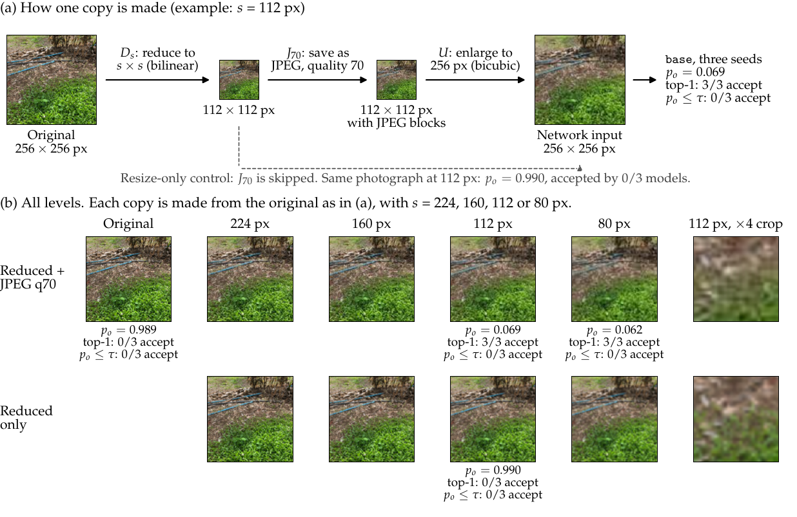
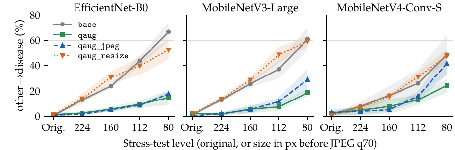
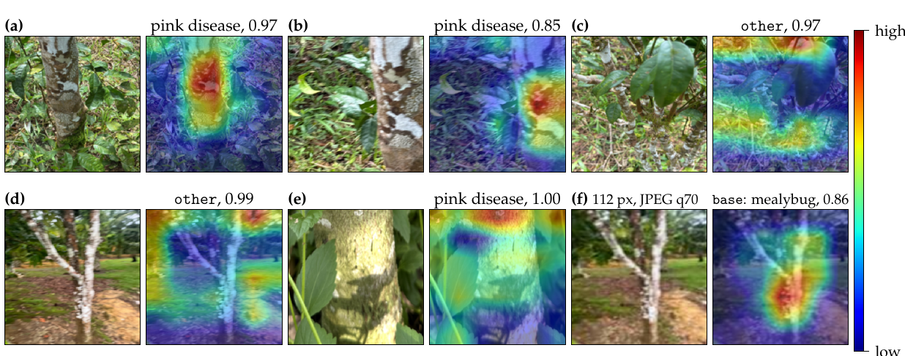

# Out-of-scope rejection under JPEG compression in smartphone durian disease classifiers


Code and results for the paper *A Failure That AUROC Does Not Show: Out-of-Scope Rejection under JPEG Compression in Smartphone Durian Disease Classifiers* (in preparation, not yet peer reviewed). The work is part of FarmFeedDurian, a mobile app for durian growers in Thailand.

A disease classifier for smartphones must decline photographs that show no durian symptom. Our EfficientNet-B0 reached about 96% accuracy and an AUROC of about 0.99 for separating disease from out-of-scope images, yet under the top-1 rule it labelled about 43% of out-of-scope images as diseased once they were reduced to 112 px and saved as JPEG. Experiments with criteria fixed in advance traced this to JPEG compression, not to image resolution.

<p align="center">
  
</p>

## Main results

EfficientNet-B0 unless stated, three seeds, 77 out-of-scope test images.

| Question | Result |
|---|---|
| Does matching the resolution of the two data sources remove the failure? | No. It closed 6% of the gap (criterion ≥ 50%). |
| Is JPEG the cause? | Yes. JPEG-only augmentation closed 103% of the gap, resize-only 11%, noise-only 6%. |
| Other architectures? | JPEG-only closed 86% (MobileNetV3-Large, confirmed) and 77% (MobileNetV4-Conv-S, below the 80% criterion). Resize-only helped in none. |
| Second durian dataset? | Same direction, about one fifth as large; the replication criterion was not met. |
| Photographs sent through LINE, Messenger or as screenshots? | None accepted on any path. The risk is images that are already small when compressed. |
| What reduces false acceptance? | JPEG augmentation of every class and a threshold on the out-of-scope probability fitted on validation images: 43.7% → 1.3% at 112 px, with about 5% of clean in-scope images rejected. |
| Can a feature-space detector replace the reject class? | No. Mahalanobis, nearest-neighbour and a DINOv2 gate ignored JPEG but accepted 26–91% of out-of-scope images at full quality. |

<p align="center">
  
</p>

The JPEG-only arm (`qaug_jpeg`) follows the full augmentation; the resize-only arm (`qaug_resize`) follows the untreated baseline.

<p align="center">
  
</p>

In the field, lichen-like bark on a non-durian tree was labelled pink disease with confidence 0.97 (a, b). The same kind of bark photographed further away was rejected (d), but after reduction and JPEG compression the baseline labelled it mealybug infestation, while the model trained with quality-aware augmentation still rejected it (f).

## Repository

```
src/durian_ood/      stress test, quality-aware augmentation, decision rules, calibration, Grad-CAM
notebooks/           the three experiments with pre-specified criteria, and a short example
results/             summary files written by those notebooks, with the recorded criteria
figure_scripts/      paper figures whose inputs are public
tests/               checks that src/ reproduces the notebook code exactly
examples/            one orchard photograph for the example notebook
docs/figures/        figures used in this README
```

| Notebook | What it tests | Criteria |
|---|---|---|
| `example_stress_test.ipynb` | builds the stress-test copies of one photograph; CPU, seconds | – |
| `13_control_quality_matching.ipynb` | does the resolution difference between sources cause the failure? | P1–P4, fixed before the run |
| `14_jpeg_confirmation.ipynb` | JPEG versus resize versus noise components; orchard photographs; dose-response | P1–P3, G, S1–S4, recorded in `results/14_jpeg_confirmation/preregistration.json` |
| `22_jpeg_three_architectures.ipynb` | the component test in MobileNetV3-Large and MobileNetV4-Conv-S | G, P1, P2, recorded in `results/22_jpeg_three_architectures/preregistration.json` |

The notebooks are the code that produced the paper's results, with comments and messages translated to English. The criteria were not changed, and notebooks 14 and 22 refuse to run if they differ from the recorded `preregistration.json`. Other analysis code (data audit, splitting, benchmark, field evaluation) is available from the authors on request.

## Getting started

```bash
pip install -r requirements.txt
pip install -e .
pytest                      # src/ against the notebook code, pixel for pixel
jupyter lab notebooks/example_stress_test.ipynb
```

```python
import numpy as np
from PIL import Image
import durian_ood as d

x = np.asarray(Image.open('examples/orchard_nondurian.jpg').convert('RGB').resize((256, 256), Image.BICUBIC))
copy_112 = d.apply_variant(x, '112px')            # reduce to 112 px, JPEG quality 70, enlarge to 256 px
control = d.apply_variant(x, '112px_nojpeg')      # same without JPEG
```

The training notebooks need the image cache described in [DATA.md](DATA.md) and a GPU. They were run on Kaggle (Tesla T4, 30 epochs, three seeds per arm, about 10 minutes per run). Each one also runs end to end on synthetic data on a CPU, for example `JPEG14_MOCK=1 DURIAN_DATA_DIR=... DURIAN_OUT_DIR=...`.

## Training recipe

`timm` ImageNet weights, AdamW (lr 1e-3, weight decay 0.05), OneCycle, class-weighted cross-entropy with label smoothing 0.1, batch 64, mixed precision, up to 30 epochs with patience 8, checkpoint selected on clean and degraded validation images, temperature scaling on validation. Quality-aware augmentation (`qaug`): random down-and-up resizing (p 0.6), JPEG quality 30–95 (p 0.6) and Gaussian noise (p 0.3), applied to every class before the usual transforms.

## Limitations

* One main disease dataset, with an out-of-scope class we assembled; the failure was much smaller on a second dataset.
* The stress test is synthetic. Real messaging-app transfer was tested only on full-size photographs of scenes already used in the analysis.
* The field data reported in the paper contain no diseased durian, and decision thresholds have not been validated on field photographs of real symptoms.
* Public class labels have not been checked by a plant pathologist.
* With 77 out-of-scope test images, one image moves a rate by 1.3 points.

Data sources and licences are in [DATA.md](DATA.md); intended use and known failure modes in [MODEL_CARD.md](MODEL_CARD.md). No images other than the example and no model weights are distributed.

## Citation

See [CITATION.cff](CITATION.cff). Until the paper is published:

```bibtex
@misc{durian_rejection_jpeg_2026,
  title  = {A Failure That AUROC Does Not Show: Out-of-Scope Rejection under
            JPEG Compression in Smartphone Durian Disease Classifiers},
  author = {Thanadon Kuttasena},
  year   = {2026},
  note   = {Manuscript in preparation},
  howpublished = {\url{https://github.com/[account]/[repository]}}
}
```

## Licence

Code under the MIT licence ([LICENSE](LICENSE)). Datasets keep their own licences.
